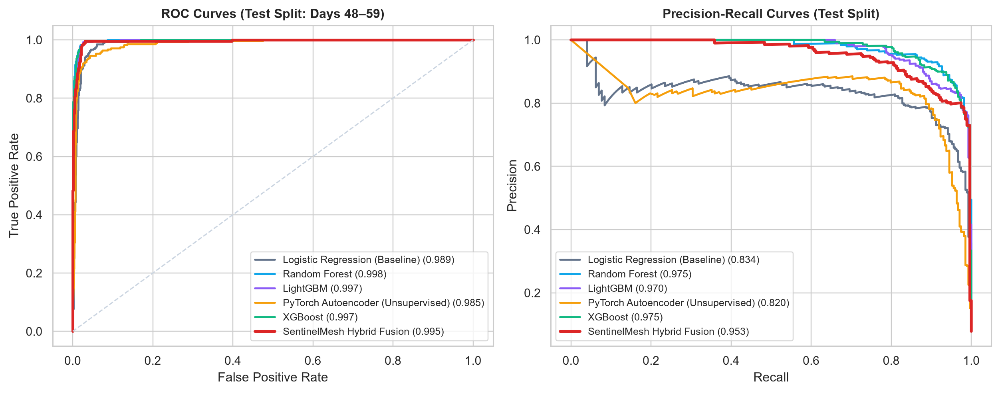
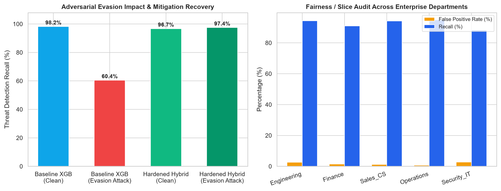

# SentinelMesh AI — Enterprise Threat Detection & Prevention System

[](https://www.python.org/)
[](#verification--tests)

**Author:** Rohit Raj · **Roll No.:** `2301730179` · **Email:** `2301730179@krmu.edu.in` · **Capstone:** 120 Marks  
**SentinelMesh AI** is a comprehensive AI-based Threat Detection, Explainable Alerting, and Adversarially Resilient SOAR prototype designed for a ~500-employee hybrid-cloud FinTech enterprise (**Meridian FinTech Inc.**).

## Deliverables in This Repository
- **Design Report (PDF Submission):** [`reports/SentinelMesh_AI_Capstone_Report.pdf`](reports/SentinelMesh_AI_Capstone_Report.pdf)
- **Design Report (Markdown Source):** [`reports/SentinelMesh_AI_Capstone_Report.md`](reports/SentinelMesh_AI_Capstone_Report.md)
- **Working ML / XAI / Adversarial / SOAR Prototype:** [`src/sentinelmesh/`](src/sentinelmesh/)
- **Benchmark Outputs & Publication Charts:** [`outputs/metrics.json`](outputs/metrics.json) and [`outputs/figures/`](outputs/figures/)

## Key Capabilities
1. **Top-5 Threat Model (`MITRE ATT&CK`):** Account Takeover (`T1078`/`T1557`), LotL & Pre-Ransomware (`T1059`/`T1486`), Stealthy Exfiltration (`T1041`/`T1567`), Cloud IAM Escalation (`T1098`/`T1548`), and Encrypted C2 Beaconing (`T1071`/`T1573`).
2. **Leak-Free Feature Engineering:** 24 sliding-window, entropy, JA3 rarity, missingness-indicator, and 30-day per-user/per-department UEBA features fitted strictly on chronological training splits with `HMAC-SHA256` PII pseudonymization.
3. **Hybrid ML/DL Engine:** Combines supervised **XGBoost** (binary + multi-threat attribution) with an unsupervised **PyTorch Deep Autoencoder** trained exclusively on benign telemetry and Platt-calibrated on validation data (`0.9533` PR-AUC, `1.90%` FPR, `4.37 ms` per 1,000 events).
4. **Adversarial Resilience:** Demonstrates constrained evasion recall collapse (`98.17% → 60.44%` on baseline XGBoost) and full recovery (`97.44%` under evasion) via **Adversarial Training + Monotonic Constraints + Autoencoder Disagreement Guard**.
5. **Exact TreeSHAP Stakeholder XAI:** Uses XGBoost native `pred_contribs=True` to translate technical alerts into plain-English executive & compliance incident briefings.
6. **Confidence-Gated SOAR with Circuit Breaker:** Automates reversible containment at `Risk >= 85` while capping bulk isolations per 10-minute window to prevent attacker-induced self-DoS.

## Repository Structure
```text
├── pyproject.toml
├── requirements.txt
├── src/sentinelmesh/
│   ├── config.py          # Enterprise profile, MITRE taxonomy, 24-feature specs
│   ├── data_generator.py  # 60-day, 500-user hybrid-cloud FinTech telemetry simulator
│   ├── features.py        # Leak-free UEBA baselines & HMAC-SHA256 pseudonymization
│   ├── models.py          # LogReg, RF, LightGBM, XGBoost, PyTorch Autoencoder, Fusion
│   ├── adversarial.py     # Constrained evasion simulator & hardened hybrid defense
│   ├── xai.py             # Exact TreeSHAP & non-technical stakeholder translator
│   ├── soar.py            # Confidence-gated SOAR with blast-radius circuit breaker
│   └── pipeline.py        # End-to-end benchmark, bootstrap CIs, slice audit, charts
├── scripts/
│   ├── run_benchmark.py   # Runs full pipeline -> outputs/metrics.json & figures/
│   └── build_report_pdf.py# Renders HTML design report -> PDF
├── tests/
│   └── test_sentinelmesh.py
└── reports/
    ├── SentinelMesh_AI_Capstone_Report.md
    ├── SentinelMesh_AI_Capstone_Report.html
    └── SentinelMesh_AI_Capstone_Report.pdf
```

## Quickstart & Verification
```bash
# 1. Install dependencies (inside a virtual environment)
pip install -r requirements.txt

# 2. Run unit and integration tests
pytest -v

# 3. Run the full 60-day benchmark, adversarial test, XAI demo, and chart generation
python scripts/run_benchmark.py

# 4. Rebuild the submission PDF report
python scripts/build_report_pdf.py
```

## Empirical Highlights
| Evaluation Dimension | Result |
|---|---|
| Supervised XGBoost (Clean Test) | PR-AUC `0.9753` · ROC-AUC `0.9974` · Recall `98.17%` |
| SentinelMesh Hybrid Fusion (Clean Test) | PR-AUC `0.9533` · ROC-AUC `0.9949` · **FPR `1.90%`** |
| Baseline XGBoost Under Evasion | Recall drops `98.17% → 60.44%` (`-37.7 pts`) |
| Hardened Hybrid Under Evasion | Recall recovers to **`97.44%`** (`1.87%` FPR) |
| Inference Throughput Latency | `4.37 ms` per 1,000 events |



