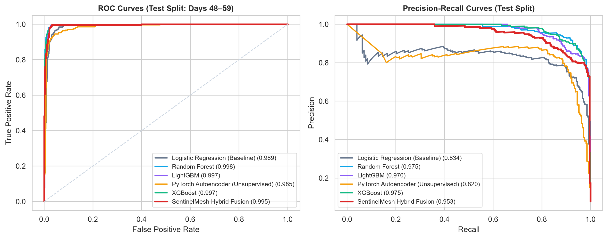
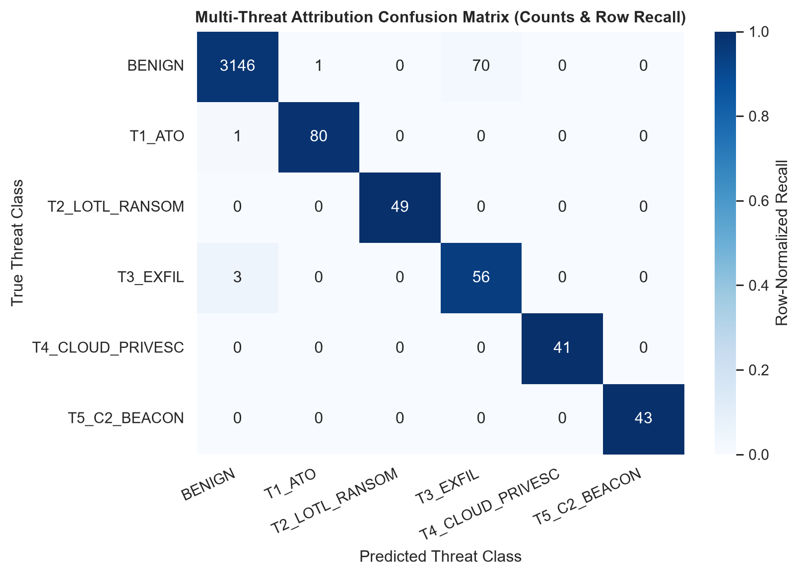
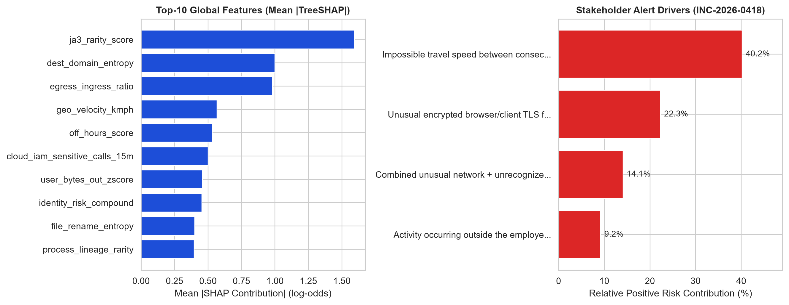
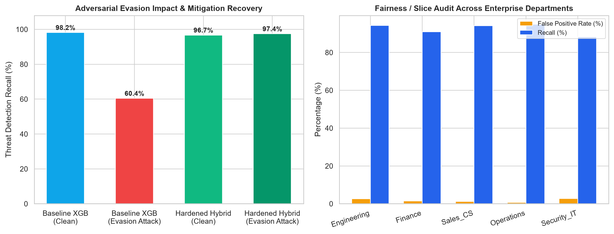

# SentinelMesh AI: Enterprise Threat Detection & Prevention System Design Report

**Target Enterprise:** Meridian FinTech Inc. (~500 employees, 650 endpoints; AWS EKS/IAM, GCP BigQuery, Okta SSO, M365, GitHub Enterprise)  
**Daily Scale:** ~1,850 avg EPS / ~7,800 peak EPS (~6.4 GB/day compressed Parquet)  
**Compliance Alignment:** PCI-DSS v4.0, SOC 2 Type II, GDPR Art. 5 & Art. 22  

---

## 1. Executive Summary

### Scope & Objectives
Meridian FinTech Inc. operates a hybrid-cloud SaaS financial platform where identity, endpoint, network, and cloud control-plane telemetry span both corporate endpoints and Kubernetes production workloads. **SentinelMesh AI** is designed to achieve:
- **Sub-60s MTTD** across both known MITRE ATT&CK behaviors and zero-day anomalies.
- **Automated reversible containment (<5s)** for critical threats (`Risk >= 85/100`) with blast-radius circuit breakers.
- **Low alert fatigue (<2% False Positive Rate)** via calibrated hybrid scoring and entity-aware UEBA baselines.
- **Stakeholder-ready Explainable AI (XAI)** translating exact TreeSHAP contributions into plain-English business briefings.
- **Privacy-by-design** ingestion using HMAC-SHA256 pseudonymization and metadata-only telemetry.

### Key Design Decisions
| Decision | Trade-Off & Justification |
|---|---|
| **Hybrid Dual-Engine (XGBoost + PyTorch Autoencoder)** | Combines supervised precision on T1–T5 (`0.9753` PR-AUC) with unsupervised anomaly detection (`0.9846` ROC-AUC) for zero-day and evasion coverage. |
| **Metadata + Sliding-Window Features (No Payload DPI)** | Preserves employee/customer privacy while cutting compute/storage costs and sustaining `4.37 ms` per 1,000 events inference latency. |
| **HMAC-SHA256 Pseudonymization at Ingestion** | Prevents unauthorized employee profiling in the analytics tier while preserving deterministic 30-day UEBA baselines and dual-custody break-glass incident unmasking. |
| **Confidence-Gated SOAR + Circuit Breaker** | Automates reversible containment at `Risk >= 85` while halting bulk auto-isolations if >5 hosts trigger in 10 minutes to prevent self-DoS. |

---

## 2. Threat Model (Top-5 Enterprise Threats & AI/ML Detection Strategy)

| ID | Threat Type (MITRE ATT&CK) | Enterprise Justification | AI/ML Detection Strategy |
|---|---|---|---|
| **T1** | **Credential Stuffing, AiTM Phishing & Account Takeover** (`T1078, T1110, T1557`) | #1 initial access vector in Okta/M365 SaaS; AiTM proxies steal session tokens bypassing MFA. | Supervised XGBoost over auth velocity, impossible travel (`geo_velocity_kmph`), TLS `ja3_rarity_score`, and `identity_risk_compound`. |
| **T2** | **LotL Lateral Movement & Pre-Ransomware** (`T1059, T1021, T1486`) | Abuse of PowerShell/WMI/`kubectl` evades signature AV before production encryption. | Process lineage (`process_lineage_rarity`), dept-normalized `dept_admin_burst_zscore`, `internal_port_fanout_15m`, and `file_rename_entropy`. |
| **T3** | **Stealthy Data Exfiltration & Staging** (`T1041, T1048, T1567`) | Customer PII and PCI-DSS records in BigQuery/S3 face severe breach liability; low-and-slow exports evade static thresholds. | Unsupervised PyTorch Autoencoder + XGBoost monitoring 30-day `user_bytes_out_zscore`, `egress_ingress_ratio`, and `dest_domain_entropy`. |
| **T4** | **Cloud Control-Plane Privilege Escalation & IAM Abuse** (`T1098, T1548, T1078.004`) | Compromised CI/CD or IAM tokens can execute cross-account `AssumeRole` chains to production payment DBs. | IAM API burst (`cloud_iam_sensitive_calls_15m`), `cross_account_hops`, and caller `ja3_rarity_score` / `new_asn_flag`. |
| **T5** | **Encrypted C2 Beaconing & Malware Callback** (`T1071, T1573`) | Persistent HTTPS/DNS C2 survives credential resets; TLS hides payload contents. | Periodicity jitter modeling (`beacon_periodicity_score`), `nxdomain_ratio_1h`, and DGA `dest_domain_entropy`. |

---

## 3. System Architecture (End-to-End Pipeline)

1. **Data Ingestion:** Vector/OpenTelemetry collectors stream Okta, M365, Sysmon/EDR, Zeek/VPC Flow, DNS, and CloudTrail/GCP Audit logs into Kafka/Redpanda. Events undergo schema validation and deterministic `HMAC-SHA256` user pseudonymization before landing in hot/cold storage.
2. **Feature Engineering (24 Features):** Strictly fitted on the chronological training split (Days 0–35) before transforming validation (Days 36–47) and test (Days 48–59) windows. Includes auth/network velocity, 30-day per-user and per-department UEBA Z-scores, Shannon domain entropy, TLS JA3 rarity, composite identity risk, and explicit missingness flags (`geo_velocity_missing_flag`, `bytes_out_missing_flag`).
3. **ML/DL Detection & Calibration:**
   - **Supervised:** XGBoost binary detector + 6-class threat-attribution classifier.
   - **Unsupervised:** PyTorch Symmetric Autoencoder (`24 → 16 → 8 → 16 → 24`) trained solely on benign traffic.
   - **Fusion:** Platt-calibrated logistic meta-learner producing Risk Scores `[0, 100]`.
4. **Alerting & XAI:** Exact TreeSHAP (`pred_contribs=True`) + Autoencoder per-feature MSE attribution translated into stakeholder briefings.
5. **Confidence-Gated SOAR:**
   - `<40`: Cold log only
   - `40–69`: Tier-1 ticket + push verification
   - `70–84`: FIDO2 step-up MFA + temporary IAM read-only / egress rate-limit
   - `>=85`: Reversible Okta token revoke + STS deny + EDR network isolation (capped at 5 isolations / 10 min by the circuit breaker).

### Benchmark Model Comparison (Held-Out Test Split: Days 48–59, n = 3,490)
| Model | PR-AUC (95% Bootstrap CI) | ROC-AUC | F1 | Precision | Recall | FPR |
|---|---:|---:|---:|---:|---:|---:|
| Logistic Regression (Baseline) | 0.8344 [0.7852, 0.8806] | 0.9885 | 0.7663 | 0.6346 | 0.9670 | 0.0472 |
| PyTorch Autoencoder (Unsupervised) | 0.8202 [0.7746, 0.8794] | 0.9846 | 0.8226 | 0.7515 | 0.9084 | 0.0255 |
| LightGBM | 0.9704 [0.9581, 0.9815] | 0.9970 | 0.8683 | 0.7807 | 0.9780 | 0.0233 |
| Random Forest | 0.9747 [0.9631, 0.9843] | 0.9977 | 0.8687 | 0.7791 | 0.9817 | 0.0236 |
| XGBoost | **0.9753** [0.9634, 0.9846] | 0.9974 | 0.8645 | 0.7723 | 0.9817 | 0.0246 |
| **SentinelMesh Hybrid Fusion** | 0.9533 [0.9355, 0.9692] | 0.9949 | 0.8659 | **0.8070** | 0.9341 | **0.0190** |

---

## 4. Adversarial ML Threat Analysis & Mitigation

- **Attack Vector:** Under constrained test-time evasion (throttled slow-drip exfiltration, C2 timing jitter, business-hour blending, residential proxy ASN masking), baseline XGBoost detection recall drops from **98.17% to 60.44%** (`PR-AUC` `0.9753 → 0.6890`). Baseline-poisoning ("boiling-the-frog") and threshold probing pose secondary risks.
- **Mitigation Strategy:** **Adversarial Training + Monotonic Invariant Constraints (`monotone_constraints=+1` on 20 risk-increasing features) + Benign Autoencoder Disagreement Guard** (plus excluding `Risk >= 40` events from 30-day UEBA baseline updates).
- **Verified Recovery:** Hardened Hybrid achieves **96.70%** clean recall (`1.87%` FPR) and recovers evasion recall to **97.44%** (`PR-AUC 0.9385`).

---

## 5. Explainable AI (XAI) for Non-Technical Stakeholders

Using exact TreeSHAP (`pred_contribs=True`), Incident **INC-2026-0418** (`Engineering`, `usr_1f6dbd33051bfbbc`, Risk Score `85.0/100`) is translated directly into business terms:
- **What Happened:** Account pattern strongly matches Credential Stuffing / AiTM Phishing & Account Takeover (`99%` unsupervised anomaly score).
- **Top Plain-English Risk Drivers:**
  1. Impossible travel speed between consecutive logins (**40.2%** of risk)
  2. Unusual encrypted browser/client TLS fingerprint (**22.3%** of risk)
  3. Combined unusual network + unrecognized device + off-hours login (**14.1%** of risk)
  4. Activity outside employee's normal working hours (**9.2%** of risk)
- **Automated Action & Decision Needed:** Step-up FIDO2 MFA + temporary IAM read-only/rate-limit applied; manager confirmation requested to restore access within 2 minutes if legitimate urgent travel.

---

## 6. Ethical, Privacy & Regulatory Considerations

- **Primary Concern:** Continuous behavioral surveillance risks employee chilling effects, HR function creep, and disparate false-positive burden. Our empirical slice audit confirms **Engineering (2.61% FPR)** and **Security_IT (2.70% FPR)** experience ~3.7x higher FPR than **Operations (0.71% FPR)** due to legitimate on-call activity.
- **Safeguards:** Strict organizational separation from HR, HMAC-SHA256 pseudonymization with dual-custody CISO + Legal break-glass unmasking, metadata-only capture with 7d/90d retention TTLs, reversible human-appealable containment (GDPR Art. 22), and quarterly role-calibrated fairness audits.

